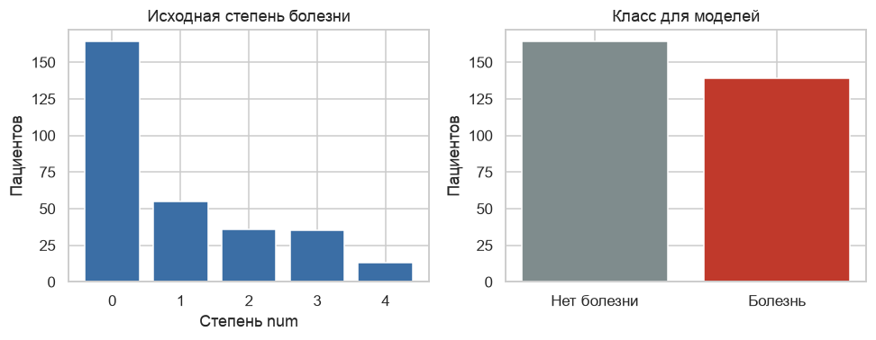
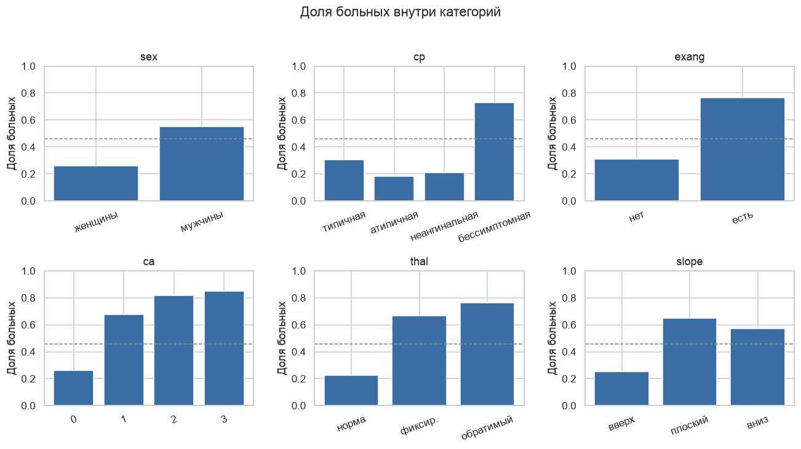
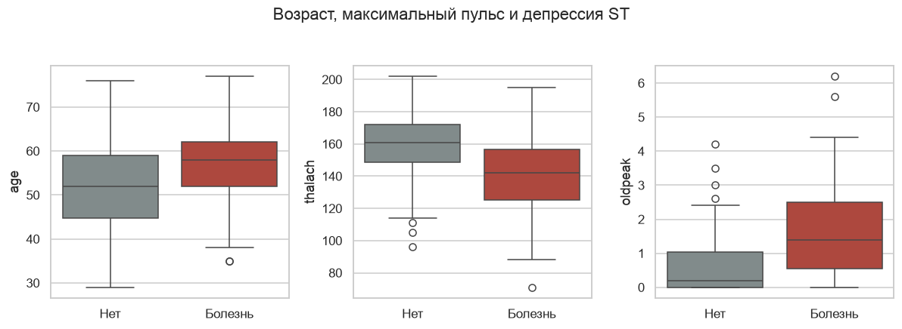
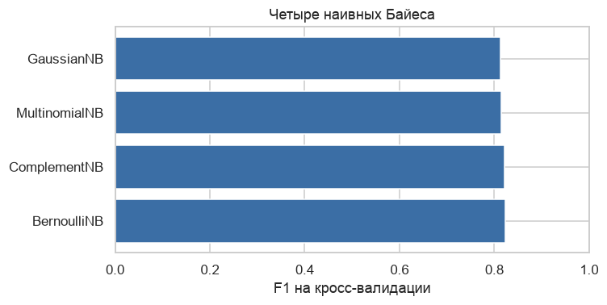
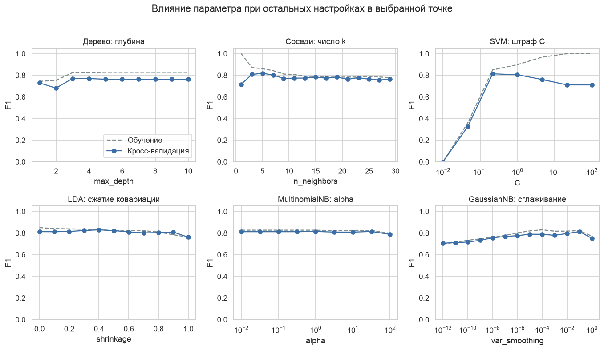
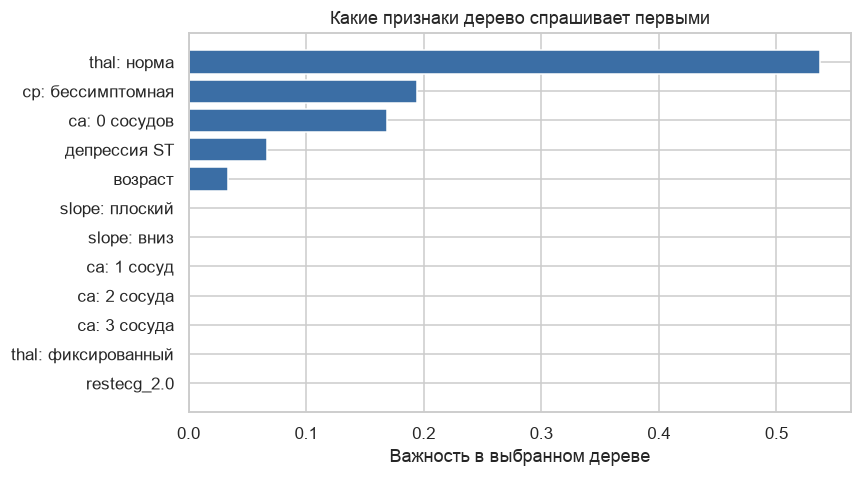
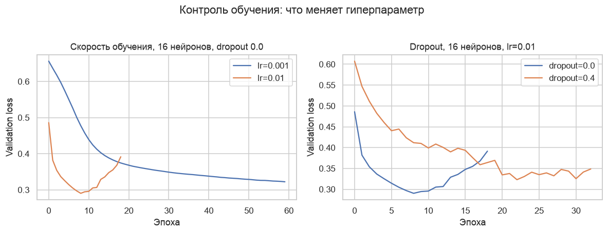
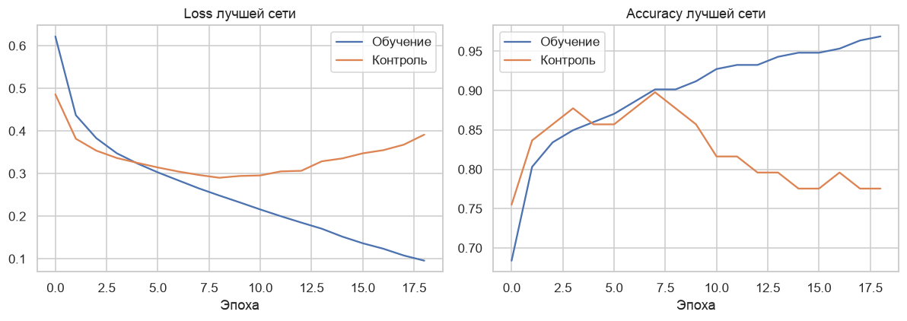
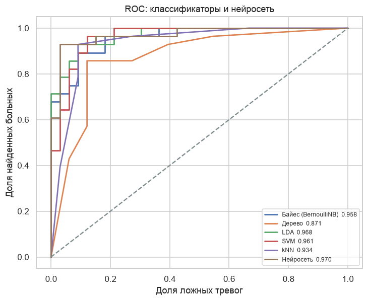
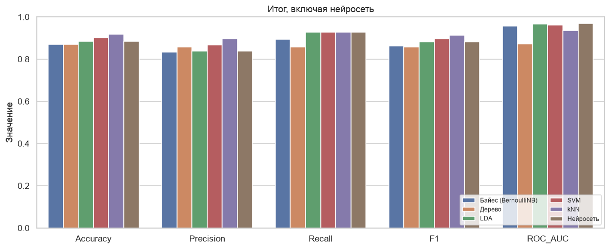

# Лабораторная работа 2. Классификация и нейронные сети

Датасет: Heart Disease, Cleveland, UCI Machine Learning Repository, dataset 45.  
Программа отчёта: `lab2_classification.ipynb`. Картинки лежат в `figures/`, логи TensorBoard — в `logs/`.

## Введение

Цель работы — сравнить методы классификации из scikit-learn и небольшую нейронную сеть TensorFlow на одной и той же задаче: по медицинским признакам решить, есть ли у пациента болезнь сердца.

Задачи:

1. Подготовить кливлендскую таблицу и зафиксировать положительный класс.
2. Разделить выборку на обучение и тест так, чтобы доли классов сохранились.
3. Обучить наивный Байес (четыре варианта из задания), дерево решений, LDA, SVM и k ближайших соседей.
4. Для каждого метода перебрать гиперпараметры и показать, как они двигают качество.
5. Построить сеть на TensorFlow, снять кривые обучения и записать их в TensorBoard.
6. Сравнить accuracy, precision, recall, F1 и ROC-AUC и выбрать подход для этого датасета.

Случайность зафиксирована: `random_state=42`. Положительный класс везде один — «болезнь есть». Precision — доля настоящих больных среди тех, кого модель назвала больными. Recall — какую долю настоящих больных модель нашла. F1 — их гармоническое среднее. ROC-AUC не зависит от порога 0.5: это вероятность, что случайный больной получит оценку выше случайного здорового.

## Выбор и подготовка датасета

Использован обработанный файл Cleveland Clinic Foundation из архива UCI, `data/cleveland_heart.csv`: 303 пациента и 14 полей, которыми пользовались в опубликованных экспериментах. Венгерская, швейцарская и лонг-бичская таблицы из того же репозитория не брались: там больше пропусков, а классические сравнения шли по Кливленду. Авторы сбора данных: Andras Janosi, William Steinbrunn, Matthias Pfisterer, Robert Detrano.

Признаки:

| Столбец | Смысл |
| --- | --- |
| age | возраст, годы |
| sex | пол: 1 мужчина, 0 женщина |
| cp | боль в груди: 1 типичная стенокардия, 2 атипичная, 3 неангинальная, 4 бессимптомная |
| trestbps | давление в покое, мм рт. ст. |
| chol | холестерин, мг/дл |
| fbs | сахар натощак выше 120 мг/дл |
| restecg | ЭКГ в покое: 0 норма, 1 аномалия ST-T, 2 гипертрофия |
| thalach | максимальный пульс на нагрузке |
| exang | стенокардия на нагрузке |
| oldpeak | депрессия ST относительно покоя |
| slope | наклон пика ST: 1 вверх, 2 плоский, 3 вниз |
| ca | число крупных сосудов 0–3 по флюороскопии |
| thal | сцинтиграфия: 3 норма, 6 фиксированный дефект, 7 обратимый дефект |
| num | степень болезни 0–4 |

Цель моделей — не сама степень `num`, а наличие болезни. В описании UCI сказано, что эксперименты на Кливленде отличают отсутствие болезни (0) от её наличия (1–4). Степень 4 есть только у 13 человек, для пяти методов и сети этого мало. Поэтому `disease = 1`, если `num > 0`. Без болезни 164 человека, с болезнью 139, доля больных 45.9%.



Пропуски стоят только там, где в исходном файле был знак вопроса: 4 значения `ca` и 2 значения `thal`. Строки не выбрасываются. Оба поля категориальные, пропуск заполняется самым частым значением. Медиана для числа сосудов дала бы дробь, которой в данных не бывает. Заполнение стоит внутри пайплайна и учится заново на каждом блоке кросс-валидации.

Остальные числовые признаки (возраст, давление, холестерин, пульс, депрессия ST) заполняются медианой, хотя пропусков в них нет: шаг оставлен в пайплайне, чтобы схема не зависела от конкретного файла. `sex`, `fbs` и `exang` уже флаги. `cp`, `restecg`, `slope`, `ca` и `thal` разворачиваются в индикаторы.

Масштаб зависит от метода. Дереву он не нужен. Байесу с нормальным распределением, LDA, SVM, kNN и сети числовые признаки стандартизируются. MultinomialNB и ComplementNB не принимают отрицательные числа, для них шкала сжимается в отрезок от 0 до 1. BernoulliNB после этого режет признак пополам: выше середины обучающего диапазона — 1, иначе 0. Индикаторы 0/1 при таком пороге не меняются.

До моделей болезнь уже видна по категориям. Бессимптомный тип боли — 73% больных, атипичная боль — 18%. Стенокардия на нагрузке — 77% против 31%. Ноль сосудов — 26%, три сосуда — 85%. Нормальная сцинтиграфия — 22%, обратимый дефект — 76%. У женщин больны 26%, у мужчин 55%. Средний максимальный пульс 158 у здоровых и 139 у больных, депрессия ST 0.59 против 1.57. Холестерин и сахар натощак классы почти не разделяют.





## Разбиение выборки

`train_test_split`, доля теста 0.2, `stratify` по классу болезни, `random_state=42`.

| Часть | Пациентов | Доля больных |
| --- | ---: | ---: |
| Обучение | 242 | 0.459 |
| Тест | 61 | 0.459 |

Тест не участвует в сетках и в ранней остановке. Внутри обучающих 242 — пять стратифицированных блоков. Модель выбирается по F1 на этих блоках: accuracy при доле больных 46% слишком легко набирается правилом большинства, а F1 одновременно штрафует пропуски больных и ложные тревоги.

Для сети обучение делится ещё раз: 193 пациента учат веса, 49 следят за validation loss. Из-за этого у сети меньше строк, чем у LDA и SVM. На 303 пациентах это заметная оговорка, она учтена в выводе.

## Методы классификации

1. **Наивный Байес** считает признаки независимыми при известном классе. `GaussianNB` предполагает нормальное распределение и получает стандартизированные признаки. `MultinomialNB` и `ComplementNB` работают с неотрицательными значениями после MinMax. Complement дополнительно выправляет перекос в сторону частого класса. `BernoulliNB` видит только флаги.
2. **Дерево решений** задаёт последовательность вопросов «признак меньше порога?». Глубина и размер листа ограничивают запоминание отдельных пациентов.
3. **LDA** проводит линейную границу. Классы считаются нормальными облаками с общей формой. Параметр `shrinkage` поджимает оценку ковариации к диагональной. Решатель `lsqr`: сжатие в scikit-learn доступно ему.
4. **SVM** ищет границу с максимальным зазором. Линейное ядро даёт прямую, RBF — кривую. `C` — цена ошибки на обучении. Для ROC используется отступ от границы, а не отдельная калибровка вероятностей.
5. **k ближайших соседей** отдаёт класс большинства среди k самых похожих пациентов обучающей выборки. При k = 1 это копия ближайшего пациента.

Все пять методов стоят в пайплайне: заполнение пропусков и нужный масштаб входят в кросс-валидацию, а не считаются один раз на всей таблице.

## Настройка гиперпараметров

Критерий сетки — средний F1 по пяти блокам. Кривые ниже построены так: остальные параметры зафиксированы в выбранной точке, меняется один. Пунктир — F1 на обучающих блоках, линия с точками — на проверочном.

**Наивный Байес.** Сетка `alpha` для трёх дискретных вариантов и `var_smoothing` для нормального.

| Вариант | Лучший параметр | F1, кросс-валидация |
| --- | --- | ---: |
| BernoulliNB | alpha ≈ 3.16 | 0.823 |
| ComplementNB | alpha = 100 | 0.822 |
| MultinomialNB | alpha = 1 | 0.815 |
| GaussianNB | var_smoothing = 0.1 | 0.814 |



Разрыв около одной сотой. В сравнение методов идёт BernoulliNB: полезный сигнал сидит во флагах «сцинтиграфия в норме», «бессимптомная боль», «ноль сосудов». У ComplementNB лучший `alpha` упёрся в верх сетки, и даже там он не обогнал Бернулли. У GaussianNB без сильного сглаживания дисперсии F1 падает примерно до 0.70: индикаторы плохо похожи на нормальное облако.

**Дерево.** Глубина от 1 до 10, минимум пациентов в листе 1, 5 или 10. Выбраны глубина 3 и лист из 10, F1 кросс-валидации 0.770. После глубины 3 проверка встаёт на полку, обучение остаётся выше. Дерево в первую очередь спрашивает нормальную сцинтиграфию, затем бессимптомную боль и отсутствие окрашенных сосудов.

**LDA.** Сжатие от 0 до 1 с шагом 0.1. Оптимум 0.4, F1 0.830. Это лучший результат кросс-валидации среди всех классификаторов. Полное сжатие, при котором признаки считаются независимыми, уже хуже.

**SVM.** Линейное ядро и RBF, C от 0.01 до 100, для RBF ещё `gamma` в значениях `scale`, 0.1 и 1. Выбраны RBF, C ≈ 0.22 и `gamma = scale`, F1 0.813. При C = 0.01 модель почти никого не называет больным, F1 проваливается. При большом C обучение уходит к 1, а проверка падает.

**Соседи.** k от 1 до 29, веса равные или по расстоянию. Выбраны k = 5 и равные веса, F1 0.819. При k = 1 обучающий F1 равен 1: каждый пациент сам себе сосед.





## Нейронная сеть на TensorFlow

Сеть последовательная, два скрытых слоя и один выход:

- вход — уже подготовленные признаки, в этой схеме их 25 после индикаторов;
- полносвязный слой на 8, 16 или 32 нейрона, активация ReLU;
- Dropout 0 или 0.4;
- второй полносвязный слой вдвое уже, но не уже 4 нейронов, снова ReLU;
- выходной нейрон с сигмоидой, оценка от 0 до 1.

Потеря — бинарная кросс-энтропия. Оптимизатор — Adam. Скорость обучения 0.001 или 0.01. Размер пакета 16. Максимум 60 эпох. Ранняя остановка смотрит на validation loss, ждёт 10 эпох без улучшения и возвращает веса лучшей эпохи. Порог класса на тесте — 0.5.

Сетка из 12 запусков, по всем сочетаниям ширины, dropout и скорости:

| Запуск | Эпоха остановки | Validation loss | Validation AUC | Validation accuracy |
| --- | ---: | ---: | ---: | ---: |
| 16 нейронов, dropout 0, lr 0.01 | 9 | 0.290 | 0.939 | 0.878 |
| 32 нейрона, dropout 0.4, lr 0.001 | 48 | 0.300 | 0.945 | 0.816 |
| 32 нейрона, dropout 0, lr 0.001 | 44 | 0.302 | 0.950 | 0.837 |
| остальные запуски | 4–60 | 0.305–0.449 | 0.913–0.962 | 0.837–0.878 |

Лучший по контрольному loss — 16 нейронов, без dropout, скорость 0.01, остановка на 9-й эпохе. Dropout 0.4 не выигрывает ни при одной ширине. Сеть на 32 нейрона близка к сети на 16 и не лучше.

На графике скорость 0.01 быстро доходит до минимума и дальше контрольный loss растёт: это переобучение, его и обрывает остановка. Скорость 0.001 к 60-й эпохе всё ещё снижается и остаётся хуже. Dropout 0.4 при скорости 0.01 учится медленнее и держится на более высоком loss. На 49 контрольных пациентах выключение нейронов только мешает. Смена ReLU на другую активацию в сетку не входила: при таком числе строк форма активации спрячется в шуме раньше, чем ширина и скорость.





Каждый запуск пишет события в `logs/<имя_запуска>/train` и `.../validation`. У лучшего запуска TensorBoard читает `epoch_loss`, `epoch_accuracy` и `epoch_auc`. Запуск из папки `lab2`:

```bash
.venv/bin/tensorboard --logdir logs
```

Кривые в отчёте построены из той же истории, чтобы текст читался и без открытого TensorBoard.

На тесте сеть даёт accuracy 0.885, precision 0.839, recall 0.929, F1 0.881, ROC-AUC 0.970.

## Сравнительный анализ

Базы, от которых есть смысл отталкиваться: правило «все здоровы» даёт accuracy 0.541, правило «все больны» даёт F1 0.629 при recall 1 и precision 0.459.

| Модель | Accuracy | Precision | Recall | F1 | ROC-AUC | F1 на кросс-валидации |
| --- | ---: | ---: | ---: | ---: | ---: | ---: |
| Байес (BernoulliNB) | 0.869 | 0.833 | 0.893 | 0.862 | 0.958 | 0.823 |
| Дерево, глубина 3 | 0.869 | 0.857 | 0.857 | 0.857 | 0.871 | 0.770 |
| LDA, сжатие 0.4 | 0.885 | 0.839 | 0.929 | 0.881 | 0.968 | **0.830** |
| SVM, RBF, C ≈ 0.22 | 0.902 | 0.867 | 0.929 | 0.897 | 0.961 | 0.813 |
| kNN, k = 5 | **0.918** | **0.897** | 0.929 | **0.912** | 0.934 | 0.819 |
| Сеть, 16 нейронов | 0.885 | 0.839 | 0.929 | 0.881 | **0.970** | — |





На кросс-валидации порядок однозначный: LDA, затем Бернулли, соседи, SVM и с отрывом дерево. На тесте из 61 человека порядок другой: по F1 впереди kNN. Один пациент на этом тесте стоит около 1.6 пункта accuracy, поэтому третьим знаком тест не переопределяет кросс-валидацию.

Recall у LDA, SVM, kNN и сети одинаковый, 0.929. Они находят одну и ту же долю больных и различаются числом ложных тревог. Дерево хуже и по F1, и по AUC: глубина 3 даёт мало разных оценок, кривая ROC грубее.

Сеть совпадает с LDA по accuracy, precision, recall и F1 и на две тысячные обгоняет его по AUC. Два слоя ReLU на 193 строках не построили границу, которая классифицирует заметно лучше прямой. Dropout и лишняя ширина контрольный loss не снизили.

Для этого датасета основной метод — LDA со сжатием 0.4. У него лучший F1 на кросс-валидации, ROC-AUC 0.968 и простая линейная граница, которую можно связать с признаками. kNN оставить как наблюдение, что на коротком тесте локальное правило один раз оказалось удачливее. Сеть оставить как проверку: нелинейность и TensorBoard здесь видны, а выигрыша классификации над LDA нет. Бернулли — лучший из наивных Байесов и почти догоняет линейные методы, потому что сильные признаки категориальные. Дерево полезно тем, что прямо показывает те же признаки, но как классификатор оно слабее.

## Заключение

На 303 пациентах Кливленда болезнь сердца по 13 признакам отделяется от её отсутствия уверенно: все рассмотренные методы выше обеих наивных баз, ROC-AUC у всех, кроме дерева, выше 0.93.

Гиперпараметры ведут себя ожидаемо. Слишком свободное дерево и k = 1 запоминают обучение. Слишком маленький штраф SVM почти не вызывает тревог, слишком большой запоминает выборку. Сглаживание Байеса нужно, но смена формулы с нормальной на бернуллиевскую даёт больше, чем тонкая настройка `alpha`. Сжатие LDA имеет пологий оптимум около 0.4.

Сеть с ReLU, сигмоидой на выходе, кросс-энтропией и Adam учится за 9 эпох при скорости 0.01 и дальше начинает переобучаться. Это видно и на графике validation loss, и в логах TensorBoard. На тесте она повторяет LDA.

Итоговый выбор для датасета — линейный дискриминантный анализ. Данных мало, граница близка к линейной, а самые сильные признаки — несколько категориальных флагов. Более гибкие SVM, соседи и сеть этот потолок заметно не поднимают, если судить по кросс-валидации, а не по одному короткому тесту.

## Источники

1. Janosi A., Steinbrunn W., Pfisterer M., Detrano R. Heart Disease. UCI Machine Learning Repository. DOI: https://doi.org/10.24432/C52P4X . Страница: https://archive.ics.uci.edu/dataset/45/heart+disease
2. Detrano R. et al. International application of a new probability algorithm for the diagnosis of coronary artery disease // American Journal of Cardiology. 1989. Vol. 64. P. 304–310.
3. Pedregosa F. et al. Scikit-learn: Machine Learning in Python // Journal of Machine Learning Research. 2011. Vol. 12. P. 2825–2830. URL: https://scikit-learn.org/
4. Abadi M. et al. TensorFlow: Large-Scale Machine Learning on Heterogeneous Systems. 2015. URL: https://www.tensorflow.org/
5. TensorBoard. URL: https://www.tensorflow.org/tensorboard
